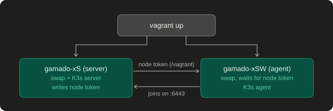
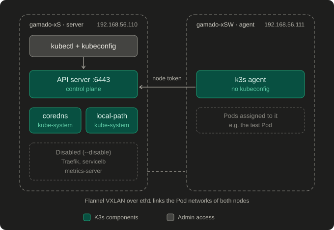

# Part 1 — K3s & Vagrant

A two-node K3s cluster on two Debian VMs: the server `gamado-xS` (`192.168.56.110`) and the worker `gamado-xSW` (`192.168.56.111`), each with 1 CPU and 1 GB of RAM.

## Index

- [Prerequisites](#prerequisites)
- [Usage](#usage)
- [Verification](#verification)
  - [Resources](#resources)
  - [Network and Node IPs](#network-and-node-ips)
  - [Server Mode](#server-mode)
  - [The Worker Runs Pods](#the-worker-runs-pods)
  - [Fresh Start on a New Machine](#fresh-start-on-a-new-machine)
- [What Part 1 Shows](#what-part-1-shows)
- [Concepts Behind Part 1](#concepts-behind-part-1)

---

## Prerequisites

The host needs [VirtualBox](https://www.virtualbox.org/) and [Vagrant](https://www.vagrantup.com/).

---

## Usage

Create and provision both VMs from the `p1` folder:

```bash
cd p1
```

```bash
vagrant up
```

Both should be `running`:

```bash
vagrant status
```

Open a shell on the server (where `kubectl` works) or on the worker:

```bash
vagrant ssh gamado-xS
```

```bash
vagrant ssh gamado-xSW
```

Delete both VMs (this also removes `k3s-token`):

```bash
vagrant destroy -f
```

More commands in the [Vagrant guide](../docs/vagrant.md#3-essential-commands).

---

## Verification

Run these inside the VMs to check the subject requirements.

### Resources

Expect `1`:

```bash
nproc
```

Expect a total a little under 1 GiB (around 950 MiB, it varies by machine):

```bash
free -h
```

`free` shows less than 1024 MiB because the kernel reserves part of the memory at boot and does not count it as usable. The `Swap` line shows 1.0Gi: a swap file on disk that keeps K3s from freezing the VM, while RAM stays at 1 GB (see [Swap in p1](../docs/k8s_concepts.md#swap-in-p1)).

### Network and Node IPs

Expect `inet 192.168.56.110/24` on the server and `192.168.56.111/24` on the worker:

```bash
ip a show eth1
```

On the server, check the IPs K3s registered:

```bash
k get nodes -o wide
```

```text
NAME         STATUS   ROLES           INTERNAL-IP
gamado-xs    Ready    control-plane   192.168.56.110
gamado-xsw   Ready    <none>          192.168.56.111
```

`ip a` only shows the address the OS assigned; `INTERNAL-IP` is the one K3s registered. Both must be `192.168.56.x`. If K3s shows `10.0.2.15`, it picked the NAT interface (see [Private Network](../docs/vagrant.md#5-private-network)); the scripts prevent it with `--node-ip`.

### Server Mode

On the server, `ExecStart` must run `k3s server --node-ip=192.168.56.110 ...` (on the worker, `systemctl cat k3s-agent` shows `k3s agent`):

```bash
sudo systemctl cat k3s
```

The API must listen on port 6443 for the agent and `kubectl`: `k3s-server` on `192.168.56.110:6443`, plus `127.0.0.1` and `[::1]` for local access:

```bash
sudo ss -tlnp | grep 6443
```

The worker shows `<none>` under ROLES because that column is built from `node-role.kubernetes.io/<role>` labels, and K3s adds `control-plane` only to servers. The worker still runs Pods normally. To display `worker` (purely cosmetic):

```bash
k label node gamado-xsw node-role.kubernetes.io/worker=worker
```

To remove it, end the label name with `-`:

```bash
k label node gamado-xsw node-role.kubernetes.io/worker-
```

### The Worker Runs Pods

`Ready` alone does not prove the worker runs workloads. On the server, start a test Pod pinned to the worker:

```bash
k run test --image=nginx --overrides='{"spec":{"nodeName":"gamado-xsw"}}'
```

Expect `Running` with `NODE gamado-xsw`. The first time it stays in `ContainerCreating` while the worker downloads the image; `k describe pod test` shows `Pulling image` meanwhile:

```bash
k get pod test -o wide
```

Remove it afterwards:

```bash
k delete pod test
```

### Fresh Start on a New Machine

On a machine where the project never ran, rebuild everything from scratch. This proves the token still travels from the server to the worker there:

```bash
vagrant destroy -f
```

```bash
vagrant up
```

The token only reaches the worker if `/vagrant` is a live VirtualBox shared folder. Expect `type vboxsf`:

```bash
vagrant ssh gamado-xSW -c "mount | grep vagrant"
```

---

## What Part 1 Shows

Vagrant builds two Debian VMs from one Vagrantfile, each with 1 CPU, 1 GB of RAM and a fixed IP on a host-only network (`eth1`). The server installs K3s in server mode bound to `192.168.56.110` (`--node-ip`, `--bind-address`), with Traefik, servicelb and metrics-server disabled, and copies its node token to the synced folder `/vagrant`. The worker waits for that token and installs K3s in agent mode with `K3S_URL` pointing to the server's API on port 6443, which joins it to the cluster. Only the server holds the admin kubeconfig, so `kubectl` works there; the worker just runs the Pods it is assigned. A 1 GB swap file keeps the server from freezing under memory pressure.





---

## Concepts Behind Part 1

Each link goes to the explanation in `docs/`:

| Question | Where to read |
| :--- | :--- |
| What is the difference between the server and the agent? | [Server and Agent Modes](../docs/k8s_concepts.md#server-and-agent-modes) |
| How does the worker join the cluster? What is the token? | [How an Agent Joins the Cluster](../docs/k8s_concepts.md#how-an-agent-joins-the-cluster) |
| How does the token go from one VM to the other? | [Sharing Files Between VMs](../docs/vagrant.md#sharing-files-between-vms-the-synced-folder) |
| Why are Traefik, servicelb and metrics-server disabled? | [Bundled Components Disabled in p1](../docs/k8s_concepts.md#bundled-components-disabled-in-p1) |
| Why is there swap? Does the VM have 2 GB? | [Swap in p1](../docs/k8s_concepts.md#swap-in-p1) |
| What runs on the server and what runs on the worker? | [What Runs on Each Node](../docs/k8s_concepts.md#what-runs-on-each-node) |
| How do pods on different nodes talk to each other? | [Flannel](../docs/k8s_concepts.md#pod-networking-between-nodes-in-k3s-flannel) |
| Why does `kubectl` only work on the server? | [Kubeconfig](../docs/k8s_concepts.md#kubeconfig-how-kubectl-finds-the-cluster) |
| Why does the worker show `<none>` under ROLES? | [Server Mode](#server-mode) |

---

Next: [Part 2 — K3s & Three Simple Applications](../p2/README.md)
