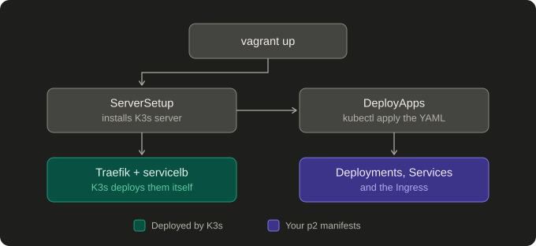
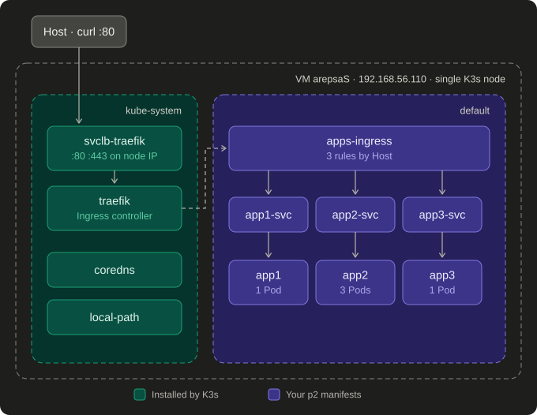
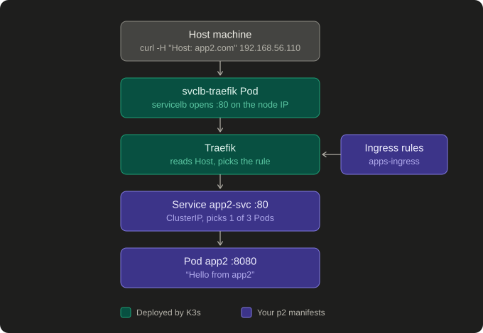
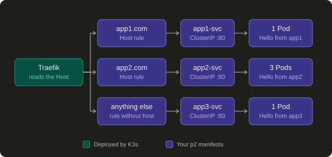

# Part 2 — K3s & Three Simple Applications

A single-node K3s cluster on the VM `arepsaS` (`192.168.56.110`, 2 CPU / 2 GB) running three web apps, routed by the HTTP `Host` header through an **Ingress**: `app1.com` goes to app1, `app2.com` to app2 (3 replicas), anything else to app3.

## Index

- [Prerequisites](#prerequisites)
- [Project Structure](#project-structure)
- [Usage](#usage)
- [Verification](#verification)
  - [From the Host](#from-the-host)
  - [Inside the VM](#inside-the-vm)
- [What Part 2 Shows](#what-part-2-shows)
- [Concepts Behind Part 2](#concepts-behind-part-2)
- [Materials](#materials)

---

## Prerequisites

The host needs [VirtualBox](https://www.virtualbox.org/) and [Vagrant](https://www.vagrantup.com/). Part 1 must be stopped, since both parts use `192.168.56.110`:

```bash
cd ../p1 && vagrant halt
```

---

## Project Structure

```text
p2/
├── Vagrantfile                  # One VM: arepsaS, 192.168.56.110
├── scripts/
│   ├── server_setup.sh          # Installs K3s in server mode
│   └── deploy_apps.sh           # Applies all Kubernetes manifests
├── apps/
│   ├── app1/                    # 1 replica,  "Hello from app1"
│   ├── app2/                    # 3 replicas, "Hello from app2"
│   └── app3/                    # 1 replica,  "Hello from app3"
└── ingress/
    └── ingress.yaml             # app1.com → app1, app2.com → app2, anything else → app3
```

Each app folder holds a Deployment and a Service. All three use the image [`paulbouwer/hello-kubernetes`](https://github.com/paulbouwer/hello-kubernetes), changing only the `MESSAGE` variable; the page also shows which Pod answered, which makes the replicas visible.

---

## Usage

Create the VM from the `p2` folder. Vagrant runs two provisioners: `ServerSetup` installs K3s and `DeployApps` applies the manifests.

```bash
cd p2
```

```bash
vagrant up
```

After editing a manifest, re-apply only the apps without reinstalling K3s:

```bash
vagrant provision --provision-with DeployApps
```

Open a shell in the VM:

```bash
vagrant ssh
```

Delete the VM:

```bash
vagrant destroy -f
```

More commands in the [Vagrant guide](../docs/vagrant.md#3-essential-commands).

---

## Verification

### From the Host

Run these on the host. `-H "Host: ..."` sets the header a browser would send when opening that name.

Expect `Hello from app1`:

```bash
curl -s -H "Host: app1.com" 192.168.56.110 | grep -i "hello from"
```

Expect `Hello from app2`:

```bash
curl -s -H "Host: app2.com" 192.168.56.110 | grep -i "hello from"
```

Expect `Hello from app3`, the default for the bare IP or any other name:

```bash
curl -s 192.168.56.110 | grep -i "hello from"
```

```bash
curl -s -H "Host: other.com" 192.168.56.110 | grep -i "hello from"
```

Repeat a request to app2 and the Pod name changes, since requests are spread across its 3 replicas:

```bash
for i in 1 2 3 4 5 6; do curl -s -H "Host: app2.com" 192.168.56.110 | grep -A1 "pod:" | tail -1; done
```

To open `http://app1.com` in a browser instead, add `192.168.56.110 app1.com app2.com` to `/etc/hosts` on the host.

### Inside the VM

One node, `control-plane`, `INTERNAL-IP` `192.168.56.110`:

```bash
k get nodes -o wide
```

5 Pods `Running` (app2 has 3), 3 `ClusterIP` Services and 3 Deployments:

```bash
k get all
```

```text
NAME                          READY   UP-TO-DATE   AVAILABLE
deployment.apps/app1-deploy   1/1     1            1
deployment.apps/app2-deploy   3/3     3            3
deployment.apps/app3-deploy   1/1     1            1
```

The Ingress rules, with app2 showing 3 backends (one per replica) and `*` as the default rule to app3. `CLASS <none>` is expected (see [Ingress vs Ingress Controller](../docs/k8s_concepts.md#ingress-vs-ingress-controller)):

```bash
k describe ingress
```

```text
Rules:
  Host        Path  Backends
  ----        ----  --------
  app1.com    /     app1-svc:80 (<pod-ip>:8080)
  app2.com    /     app2-svc:80 (<pod-ip>:8080,<pod-ip>:8080,<pod-ip>:8080)
  *           /     app3-svc:80 (<pod-ip>:8080)
```

Traefik as a `LoadBalancer` Service with `EXTERNAL-IP` `192.168.56.110`, exposed by the `svclb-traefik` Pod:

```bash
k get svc,pods -n kube-system | grep -E "traefik|svclb"
```

---

## What Part 2 Shows

Part 1 built an empty cluster; Part 2 runs applications on one and exposes them. It keeps Part 1's setup (Vagrant, K3s server, private network) on a single node and turns back on what Part 1 disabled: Traefik and servicelb. New here: three Deployments of one image, differing only by `MESSAGE` (app2 with `replicas: 3`); `ClusterIP` Services that find their Pods by label (port 80 → 8080); and one Ingress routing by `Host`: `app1.com`, `app2.com`, and a rule without `host` as the default for app3. Traefik applies the rules and servicelb exposes it on the node's IP. Named provisioners split installing K3s (`ServerSetup`) from applying the manifests (`DeployApps`).



*Provisioning: `ServerSetup` installs K3s, which deploys Traefik and servicelb by itself; `DeployApps` applies the p2 manifests, which is why it can run again alone.*



*Inside the cluster: one K3s node runs everything. `kube-system` holds what K3s installs (Traefik, servicelb, CoreDNS, local-path), and `default` holds the p2 manifests; `k get pods -A` lists the same Pods.*



*A request to `app2.com`: servicelb opens port 80 on the node, Traefik matches the `Host` header against the Ingress rules, and the Service picks one of the 3 app2 Pods. The Ingress receives no traffic: it is the rule table Traefik reads.*



*Routing: one Ingress object, `apps-ingress`, holds three rules and Traefik applies them by `Host` header. `app1.com` and `app2.com` have their own rules; any other name, or the bare IP, falls to the rule without `host` and reaches app3.*

---

## Concepts Behind Part 2

Each link goes to the explanation in `docs/`:

| Question | Where to read |
| :--- | :--- |
| What is the difference between an Ingress and an Ingress controller? | [Ingress vs Ingress Controller](../docs/k8s_concepts.md#ingress-vs-ingress-controller) |
| How does traffic on `192.168.56.110:80` reach Traefik? | [servicelb](../docs/k8s_concepts.md#how-traffic-reaches-traefik-servicelb) |
| How does the `Host` header choose the app? Why does app3 answer by default? | [The Host Header and the Default Rule](../docs/k8s_concepts.md#the-host-header-and-the-default-rule) |
| What is the full path of a request? | [Full Request Flow in p2](../docs/k8s_concepts.md#full-request-flow-in-p2) |
| How does a Service find its pods? What are `port` and `targetPort`? | [Selector, port and targetPort](../docs/k8s_concepts.md#how-a-service-finds-its-pods-selector-port-and-targetport) |
| How are the 3 replicas of app2 created? | [ReplicaSet](../docs/k8s_concepts.md#replicaset) / [Deployment](../docs/k8s_concepts.md#deployment-and-rolling-updates) |
| Why does the server script use `--flannel-iface=eth1`? | [Flannel's Interface](../docs/k8s_concepts.md#choosing-flannels-interface---flannel-iface) |
| How does `--provision-with DeployApps` work? | [Named Provisioners](../docs/vagrant.md#named-provisioners) |

---

## Materials

- [The Coding Gopher - Kubernetes Deployments and Services](https://www.youtube.com/watch?v=z9nYikBIqRA)
- [IBM - What is Ingress](https://www.youtube.com/watch?v=NPFbYpb0I7w)
- [The Coding Gopher - Kubernetes Ingress](https://www.youtube.com/watch?v=uGsR9fuBVqU)

---

Previous: [Part 1 — K3s & Vagrant](../p1/README.md) · Next: [Part 3 — K3d & Argo CD (GitOps)](../p3/README.md)
