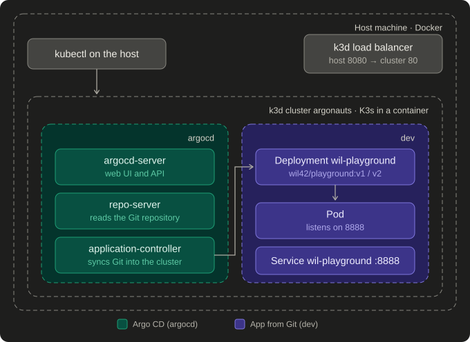
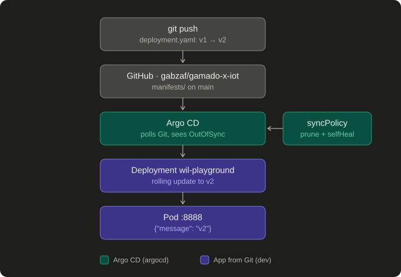

# Part 3 — K3d & Argo CD (GitOps)

A K3d cluster (`argonauts`) running in Docker on the host, with **Argo CD** in the `argocd` namespace keeping the `dev` namespace equal to a public GitHub repository. Changing the image tag in Git from `v1` to `v2` is enough to update the app.

## Index

- [Prerequisites](#prerequisites)
- [Project Structure](#project-structure)
- [The GitOps Repository](#the-gitops-repository)
- [Usage](#usage)
- [Verification](#verification)
  - [The App](#the-app)
  - [v1 → v2 Through Git](#v1--v2-through-git)
  - [Self-Healing](#self-healing)
- [What Part 3 Shows](#what-part-3-shows)
- [Concepts Behind Part 3](#concepts-behind-part-3)
- [Troubleshooting](#troubleshooting)
- [Project Plan](#project-plan)
- [Materials](#materials)

---

## Prerequisites

No Vagrant here: everything runs on a Debian host with `sudo` and internet access, and host ports `8080` and `8443` must be free. `make setup` installs Docker, K3d and kubectl itself.

---

## Project Structure

```text
p3/
├── Makefile                 # setup / test / clean / fclean / re
├── confs/
│   └── application.yaml     # Argo CD Application: watches the GitOps repo
└── scripts/
    ├── setup.sh             # Docker + K3d + kubectl, cluster, namespaces, Argo CD, Application
    ├── test.sh              # Checks the subject from the host
    ├── clean.sh             # Deletes the K3d clusters and prunes Docker
    └── fclean.sh            # clean + removes k3d, kubectl and Docker
```

---

## The GitOps Repository

The subject requires a **public** repository whose name contains a group member's login: [gabzaf/gamado-x-iot](https://github.com/gabzaf/gamado-x-iot). Its `manifests/` folder holds the `wil-playground` Deployment and Service for `dev`, using Wil's public image [`wil42/playground`](https://hub.docker.com/r/wil42/playground) (tags `v1` and `v2`, port `8888`).

---

## Usage

Run everything from the `p3` folder:

```bash
cd p3
```

Install Docker, K3d and kubectl, create the cluster and the namespaces, install Argo CD and apply the Application. It skips what is already installed and prints the Argo CD `admin` password at the end; the first run downloads about 230 MB of images:

```bash
make setup
```

If it stops with `permission denied ... docker.sock`, the `docker` group is not active in your session yet:

```bash
newgrp docker
```

Open the Argo CD interface at [https://localhost:8081](https://localhost:8081) (user `admin`) while this runs:

```bash
kubectl -n argocd port-forward svc/argocd-server 8081:443
```

Print the `admin` password again:

```bash
kubectl -n argocd get secret argocd-initial-admin-secret -o jsonpath="{.data.password}" | base64 -d; echo
```

Delete the cluster. This also runs `docker system prune -af`, which removes **every** unused Docker image on the machine:

```bash
make clean
```

Also uninstall k3d, kubectl and Docker:

```bash
make fclean
```

---

## Verification

Run every check at once. Each line prints `[PASS]` or `[FAIL]`, and it exits non-zero if anything fails:

```bash
make test
```

It covers the tools, the `argonauts` cluster and its node, the `argocd` and `dev` namespaces, every Argo CD component, the Application `Synced` and `Healthy` on a public repository, and the app answering with the version of its image tag. The sections below run the same checks by hand.

### The App

Forward the app's port in one terminal:

```bash
kubectl -n dev port-forward svc/wil-playground 8888:8888
```

In another, expect `{"status":"ok", "message": "v1"}` (or `v2`, matching the image tag in Git):

```bash
curl http://localhost:8888/
```

Argo CD's view, expecting `Synced` and `Healthy`:

```bash
kubectl get applications -n argocd
```

### v1 → v2 Through Git

In a clone of the GitOps repository, change the tag and push:

```bash
sed -i 's/playground:v1/playground:v2/' manifests/deployment.yaml
```

```bash
git commit -am "deploy v2" && git push
```

Argo CD checks Git about every 3 minutes. Watch the old Pod being replaced, then run the `curl` again and expect `v2`:

```bash
kubectl -n dev get pods -w
```

To go back, push the opposite change (`v2` → `v1`).

### Self-Healing

A manual change in the cluster does not survive: scale the app to 3 replicas and Argo CD brings it back to the 1 replica that Git declares.

```bash
kubectl -n dev scale deployment wil-playground --replicas=3
```

```bash
kubectl -n dev get pods -w
```

---

## What Part 3 Shows

Part 2 applied its manifests by hand (`kubectl apply` in a provisioner); Part 3 removes that step and makes Git the source of truth. The cluster itself also changes: instead of K3s on a Vagrant VM, K3d runs K3s inside a Docker container on the host, with a load balancer container mapping host port 8080 to the cluster's port 80. Argo CD runs in its own namespace; its `repo-server` reads [gabzaf/gamado-x-iot](https://github.com/gabzaf/gamado-x-iot) and its `application-controller` applies `manifests/` to `dev`, as described by the Application in [`confs/application.yaml`](confs/application.yaml). With `syncPolicy.automated`, a push is enough to deploy: `prune` deletes what left Git and `selfHeal` reverts manual changes.



*Inside the cluster: `kubectl` runs on the host and talks to K3s inside the `argonauts` container. Argo CD lives in `argocd`; what it reads from Git becomes the Deployment, Pod and Service in `dev`.*



*Deploying v2: a push changes the image tag in GitHub, Argo CD sees the cluster is `OutOfSync` and applies the new manifest, and the Deployment replaces the v1 Pod with a v2 one through a rolling update, with no `kubectl` involved.*

---

## Concepts Behind Part 3

Each link goes to the explanation in `docs/`:

| Question | Where to read |
| :--- | :--- |
| What is K3d, and how is it different from K3s? | [K3d](../docs/k8s_concepts.md#3-k3d) |
| What is GitOps? | [What is GitOps?](../docs/gitops_argocd.md#1-what-is-gitops) |
| What is Argo CD, and what does the Application declare? | [What is Argo CD?](../docs/gitops_argocd.md#3-what-is-argo-cd) |
| CI vs CD: which one does Argo CD do? | [CI vs. CD](../docs/gitops_argocd.md#ci-vs-cd) |
| What are namespaces? | [Namespaces](../docs/k8s_concepts.md#namespaces) |
| How does `kubectl` find the K3d cluster? | [Kubeconfig](../docs/k8s_concepts.md#kubeconfig-how-kubectl-finds-the-cluster) |
| How does v1 → v2 roll out? | [Deployment and Rolling Updates](../docs/k8s_concepts.md#deployment-and-rolling-updates) |

---

## Troubleshooting

`kubectl` reaches an old or wrong cluster: `setup.sh` keeps an existing `~/.kube/config`, so point it at `argonauts`:

```bash
k3d kubeconfig merge argonauts --kubeconfig-switch-context
```

`port is already allocated` when creating the cluster: something already uses host port `8080` or `8443`.

---

## Project Plan

### 1. Environment Setup
- [x] 1.1. Create Docker installation script
- [x] 1.2. Create K3d installation script
- [x] 1.3. Create kubectl installation script

### 2. Kubernetes Cluster Setup
- [x] 2.1. Create a K3d cluster
- [x] 2.2. Verify cluster access with kubectl
- [x] 2.3. Create required namespaces (`argocd`, `dev`)

### 3. Git Repository Setup
- [x] 3.1. Create a public GitHub repository ([gabzaf/gamado-x-iot](https://github.com/gabzaf/gamado-x-iot))
- [x] 3.2. Add Kubernetes manifests to the repository

### 4. Application Deployment Test
- [x] 4.1. Configure Wil's Playground application (`wil42/playground:v1`)
- [x] 4.2. Deploy version v1 manually for testing

### 5. Argo CD Setup
- [x] 5.1. Create a script to install Argo CD in the `argocd` namespace
- [x] 5.2. Verify Argo CD components are running
- [x] 5.3. Access the Argo CD interface

### 6. GitOps Configuration
- [x] 6.1. Create an Argo CD `Application` resource
- [x] 6.2. Connect Argo CD to the GitHub repository
- [x] 6.3. Enable automatic synchronization

### 7. Continuous Deployment
- [x] 7.1. Deploy application version v1 through Argo CD
- [x] 7.2. Update configuration to version v2
- [x] 7.3. Push changes to GitHub
- [x] 7.4. Verify automatic deployment by Argo CD

---

## Materials

- [DEV - Why You Should Use k3d for Local Development](https://dev.to/cloudx/why-you-should-use-k3d-for-local-development-a-developers-guide-2cp5)
- [DevOps Lab - GitOps with Argo CD](https://albanna-tutorials.com/devops/advanced/a03_gitops.html)

---

Previous: [Part 2 — K3s & Three Simple Applications](../p2/README.md)
